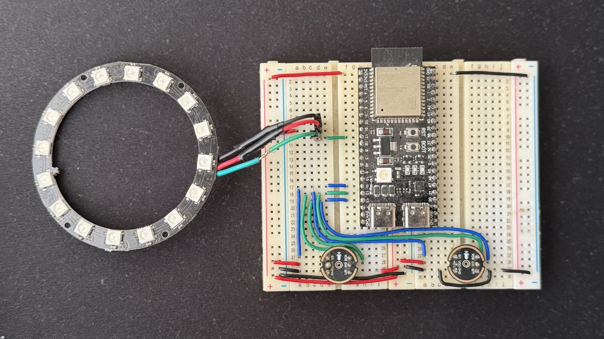
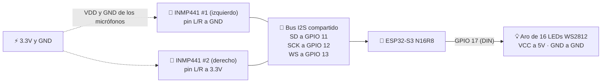

# 🎙️ Wake Word 100% Local en ESP32-S3 (3 métodos)

Haz que tu ESP32-S3 **despierte cuando le dices una palabra** (como el "Hey Siri" o el "Alexa" de tu celular), **sin internet y sin enviar tu voz a ninguna nube**. Aquí están los 3 métodos que probé, con todo el código listo para compilar y una guía paso a paso para cada uno.



---

## 📺 Video Tutorial

Si prefieres ver el proceso completo, aquí está el video:

[](https://youtu.be/t-HvkBEbQJA)

---

## 🎯 ¿Qué es una "wake word"?

Es la **palabra de activación** de un asistente de voz: "Hey Siri", "Alexa", "Hey Google"… El aparato está **escuchando todo el tiempo**, pero no hace nada hasta que oye *esa* palabra. En este proyecto, cuando el ESP32-S3 la oye, **el aro de LEDs se enciende**; ahí podrías poner cualquier cosa: prender un foco, mover un motor, empezar a grabar un comando…

La palabra del video es **"Hey Bot"** (métodos 1 y 2) y **"Hi ESP"** (método 3).

---

## 🚦 ¿Qué método elijo?

| | **Método 1** · MFCC + DTW | **Método 2** · Edge Impulse | **Método 3** · ESP-SR |
| :--- | :--- | :--- | :--- |
| **La idea en una frase** | La placa aprende **tu** voz: dices la palabra 3 veces y listo | Entrenas una **red neuronal** con grabaciones y la subes a la placa | Usas un modelo **ya hecho** por Espressif (Hi ESP, Jarvis, Sophia…) |
| **¿Entiende a otras personas?** | ❌ Solo a quien la enroló | ✅ Sí, si el modelo se entrenó con varias voces | ✅ Sí |
| **¿Puedo usar mi propia palabra?** | ✅ Cualquiera, en segundos | ✅ Cualquiera, pero hay que grabar y entrenar | ❌ Solo las que trae Espressif (una propia requiere su servicio de pago) |
| **¿Qué tan difícil es?** | 🟢 El más fácil | 🟡 Tedioso: hay que grabar y entrenar | 🔴 El más difícil de configurar |
| **Falsos positivos** (se activa sin que la digas) | Suele haber varios | Se pueden reducir entrenando con más ruido real | En mis pruebas, ninguno |
| **¿Necesito cuenta o internet?** | No | Sí, para entrenar en Edge Impulse (después ya no) | No (la primera vez se descargan las herramientas) |
| **¿Necesita PSRAM?** | No | El programa la usa (placa N16R8) | **Sí, obligatoria** |
| **Carpeta** | [`metodo_1_mfcc_dtw`](./metodo_1_mfcc_dtw) | [`metodo_2_edge_impulse`](./metodo_2_edge_impulse) | [`metodo_3_esp_sr`](./metodo_3_esp_sr) |

> 💡 **¿Primera vez con el ESP32? Empieza por el Método 1.** Además de ser el más fácil, trae un comando para probar tus micrófonos y tu aro de LEDs, así sabes que el cableado está bien antes de pasar a los otros.

---

## 🧰 Materiales

| Cantidad | Pieza | Notas |
| :---: | :--- | :--- |
| 1 | **ESP32-S3 N16R8** (16 MB de flash y 8 MB de PSRAM) | Es la placa con la que lo probé. El Método 3 necesita la PSRAM |
| 2 | **Micrófonos INMP441** (I2S) | Los tres métodos están pensados para dos micrófonos |
| 1 | **Aro de 16 LEDs WS2812** (NeoPixel) | Es el indicador: se enciende cuando oye la palabra |
| 1 | Protoboard y cables Dupont | |
| 1 | Cable USB que **sí transmita datos** | Algunos cables solo cargan y la placa nunca aparece en la computadora |
| 2 | *(Opcional)* Capacitor cerámico de 100 nF | Uno entre `VDD` y `GND` de cada micrófono: reduce el ruido |

---

## 🔌 Conexiones

Los **tres métodos usan exactamente el mismo cableado**. Conéctalo una vez y ya.



| Señal | Pin del ESP32-S3 | Micrófono 1 (izquierdo) | Micrófono 2 (derecho) | Aro de LEDs |
| :--- | :---: | :---: | :---: | :---: |
| **SD** (datos de audio) | **GPIO 11** | `SD` | `SD` | — |
| **SCK** (reloj) | **GPIO 12** | `SCK` | `SCK` | — |
| **WS** (selección de canal) | **GPIO 13** | `WS` | `WS` | — |
| **L/R** | — | a **GND** | a **3.3V** | — |
| **Alimentación** | **3.3V** | `VDD` | `VDD` | — |
| **Alimentación del aro** | **5V** | — | — | `VCC` |
| **Tierra** | **GND** | `GND` | `GND` | `GND` |
| **Datos del aro** | **GPIO 17** | — | — | `DIN` |

> ⚠️ **Tres errores comunes (me pasaron a mí):**
> 1. **El pin `L/R` de cada micrófono SIEMPRE debe ir conectado**: uno a GND y el otro a 3.3V. Si queda al aire, o si los dos van al mismo lado, chocan en la línea `SD` y escuchas puro ruido.
> 2. **Los micrófonos van a 3.3V, nunca a 5V** (se queman). **Solo el aro** va a 5V.
> 3. El aro y el ESP32 deben compartir **GND**.

> 📏 *Solo para el Método 3:* separa los dos micrófonos entre **40 mm y 65 mm**; así el procesamiento de audio puede distinguir de dónde viene tu voz.

---

## 💻 Instalación (una sola vez)

1. Instala [**Visual Studio Code**](https://code.visualstudio.com/).
2. Dentro de VS Code, abre la pestaña de **Extensiones** (`Ctrl + Shift + X`), busca **PlatformIO IDE** e instálala. Tarda unos minutos; al terminar, reinicia VS Code.
3. Descarga este proyecto: en la página del repositorio pulsa **Code ▸ Download ZIP** y descomprímelo (o clónalo con `git`).
   > ⚠️ Descomprímelo en una carpeta con **ruta corta y sin espacios ni acentos**, por ejemplo `C:\proyectos\`. Con espacios, el Método 3 puede fallar al compilar.
4. *(Solo para el Método 3)* Instala también **ESP-IDF 5.3**: las instrucciones están en el [README del Método 3](./metodo_3_esp_sr/README.md#-paso-a-paso).
5. Conecta tu placa por USB. Las placas N16R8 suelen tener **dos puertos USB-C**: usa el rotulado **UART** (también aparece como `COM`). Si Windows no lo reconoce, instala el driver del chip **CH343** (o CH340) desde el sitio del fabricante.

---

## 🚀 Tu primera prueba (Método 1)

1. En VS Code: **Archivo ▸ Abrir carpeta…** y elige **`metodo_1_mfcc_dtw`** (la carpeta del método, **no** la raíz del repositorio). PlatformIO descargará lo que necesite la primera vez.
2. Abajo, en la barra azul de PlatformIO, pulsa **→ (Upload)** para compilar y subir el programa, y luego el icono del **enchufe (Serial Monitor)**.
3. Escribe **`m`** en el monitor serial: verás barras de volumen de los dos micrófonos (`L` y `R`) subir cuando hablas, y un LED azul que va dando vueltas por el aro. Si funcionan, ¡el cableado está perfecto! (Pulsa cualquier tecla para salir.)
4. Sigue la guía del método: [`metodo_1_mfcc_dtw/README.md`](./metodo_1_mfcc_dtw/README.md).

---

## 📂 Estructura del repositorio

```text
2026-10-24-ESP32-S3-Wake-Word/
├── README.md                    ← estás aquí
├── AGENTS.md                    ← instrucciones para que una IA entienda el proyecto
├── images/                      ← fotos del circuito
├── docs/
│   ├── GUIA_CON_IA.md           ← prompts para que Claude / Gemini / Codex te ayuden
│   ├── SOLUCION_DE_PROBLEMAS.md ← "no me funciona", empieza aquí
│   └── GLOSARIO.md              ← qué significan MFCC, I2S, PSRAM… en palabras sencillas
├── metodo_1_mfcc_dtw/           ← Método 1 (PlatformIO + Arduino)
│   ├── README.md                ← guía paso a paso
│   ├── platformio.ini
│   ├── include/config.h         ← todos los números que puedes ajustar
│   ├── src/main.cpp             ← el programa
│   └── herramientas/            ← (opcional) guardar el audio que oye la placa como .wav
├── metodo_2_edge_impulse/       ← Método 2 (PlatformIO + Arduino + Edge Impulse)
│   ├── README.md
│   ├── lib/wake_word_inferencing/ ← el modelo entrenado (lo exportas de Edge Impulse)
│   ├── recolector_audio/        ← programa para grabar tu dataset
│   └── src/main.cpp
└── metodo_3_esp_sr/             ← Método 3 (ESP-IDF)
    ├── README.md
    ├── sdkconfig.defaults       ← aquí eliges la palabra de activación
    └── main/main.c
```

---

## 🤖 ¿Quieres que una IA te ayude?

Puedes pedirle a **Claude Code, Gemini CLI, Codex, Cursor o ChatGPT** que te ayude a integrar **tu propio modelo**, cambiar la palabra, ajustar valores o entender un error. Este proyecto ya incluye un archivo [`AGENTS.md`](./AGENTS.md) que los agentes leen solos, y una guía con **prompts listos para copiar**:

👉 [**docs/GUIA_CON_IA.md**](./docs/GUIA_CON_IA.md)

---

## ❓ ¿Algo no funciona?

Revisa [**docs/SOLUCION_DE_PROBLEMAS.md**](./docs/SOLUCION_DE_PROBLEMAS.md): están los problemas que me aparecieron a mí, con su solución. Si una palabra técnica no se entiende, busca en el [**glosario**](./docs/GLOSARIO.md).

---

## 📄 Licencia y créditos

Proyecto creado por **Ignacio Aguilera**. Si te sirvió, ¡no olvides compartirlo y etiquetarme!

El Método 2 incluye una librería exportada de **Edge Impulse** y el Método 3 usa **ESP-SR** de **Espressif**; ambas conservan sus propias licencias.

---

_Hecho para aprender y disfrutar del ecosistema ESP32._
